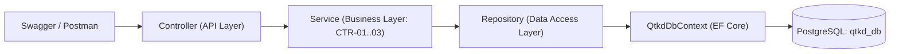

# Hệ Thống Quản Trị Kinh Doanh – QTKD API (Phase 2 – Tuần 05 & Tuần 06)

Dự án xây dựng phân hệ Backend **ASP.NET Core Web API (.NET 9)** kết nối **PostgreSQL** qua **Entity Framework Core** cho đề tài **Quản trị Kinh doanh (QTKD)** – Công ty Logistics ABC.

---

## 1. Cấu trúc Solution & Kiến trúc Phân tầng

```text
ThucHanhPhase2/
├── QTKD.sln                          # Solution chính xuyên suốt Tuần 05 – 07
├── docker-compose.yml                # Khởi chạy PostgreSQL 17 container (qtkd_db)
├── .env.example                      # Mẫu cấu hình mật khẩu PostgreSQL
├── .config/dotnet-tools.json         # Công cụ cục bộ dotnet-ef 9.0.10
├── docs/
│   ├── architecture.md               # Tài liệu thiết kế kiến trúc, ERD & đối chiếu Phase 1
│   └── week06_api_and_rules.md       # Tài liệu API Tuần 06, US03 & bảng đối chiếu CTR-01..03
└── src/
    └── QTKD.Api/
        ├── Controllers/              # API Layer: CustomersController, ContractsController, PriceListsController
        ├── DTOs/                     # Request/Response DTOs (Customers/, Contracts/, PriceLists/)
        ├── Services/                 # Business Logic Layer: Kiểm tra quy tắc CTR-01, CTR-02, CTR-03, US03
        ├── Mappings/                 # Chuyển đổi Entity <-> DTO
        ├── Repositories/             # Data Access Layer: Truy vấn EF Core (AsNoTracking, Include)
        ├── Data/                     # QtkdDbContext & Migrations (InitialCreate + Seed Data)
        ├── Entities/                 # Customer, Contract, PriceList, PriceItem
        ├── Exceptions/               # Xử lý lỗi tập trung theo chuẩn RFC 7807 ProblemDetails
        └── Program.cs                # Cấu hình DI, Middleware pipeline & Swagger UI
```

### Sơ đồ luồng xử lý của các thành phần chính



- Tài liệu kiến trúc & ERD (Tuần 05): [docs/architecture.md](docs/architecture.md)
- Tài liệu API, mẫu Request/Response & Bảng đối chiếu US03 / CTR-01..03 (Tuần 06): [docs/week06_api_and_rules.md](docs/week06_api_and_rules.md)

---

## 2. Yêu cầu Môi trường

- **.NET SDK 9.0** (`dotnet --version`)
- **Docker Desktop** (hoặc PostgreSQL 15+ cài trực tiếp trên máy ở cổng `5432`)
- **Git**

---

## 3. Hướng dẫn Cấu hình Database & Chạy Migration

### Bước 1: Tạo file `.env` và khởi động PostgreSQL bằng Docker

Tại thư mục gốc của repository (`ThucHanhPhase2`):

```powershell
# Copy file .env.example thành .env (mặc định POSTGRES_PASSWORD=123456)
Copy-Item .env.example .env

# Khởi động container PostgreSQL (qtkd-postgres)
docker compose up -d
```

### Bước 2: Cấu hình Connection String an toàn qua User Secrets

File `src/QTKD.Api/appsettings.json` chỉ chứa chuỗi kết nối không có mật khẩu. Để cung cấp mật khẩu trên máy local:

```powershell
dotnet user-secrets set "ConnectionStrings:QtkdDb" "Host=localhost;Port=5432;Database=qtkd_db;Username=postgres;Password=123456" --project src/QTKD.Api
```

### Bước 3: Khôi phục công cụ `dotnet-ef` và cập nhật Database

```powershell
dotnet restore
dotnet tool restore
dotnet ef database update --project src/QTKD.Api
```

---

## 4. Khởi động API và Danh sách Endpoint (Tuần 05 & Tuần 06)

### Chạy ứng dụng Web API

```powershell
dotnet run --project src/QTKD.Api --launch-profile http
```

- Ứng dụng lắng nghe tại: `http://localhost:5007`
- Giao diện **Swagger UI**: `http://localhost:5007/swagger`

### Tổng hợp các Endpoint

| Phân hệ | Method | Endpoint | Chức năng & Quy tắc kiểm tra | Status Code |
|---|---|---|---|---|
| **Customer** | `GET` | `/api/customers` | Xem danh sách khách hàng | `200` |
| **Customer** | `GET` | `/api/customers/{id}` | Xem chi tiết khách hàng | `200`, `404` |
| **Customer** | `POST` | `/api/customers` | Tạo mới khách hàng (kiểm tra `CustomerCode`, `Name` bắt buộc, không trùng mã) | `201`, `400`, `409` |
| **Customer** | `PUT` | `/api/customers/{id}` | Cập nhật khách hàng (kiểm tra `Name` và `Status` hợp lệ) | `200`, `400`, `404` |
| **Contract** | `GET` | `/api/contracts` | Xem danh sách hợp đồng | `200` |
| **Contract** | `GET` | `/api/contracts/{id}` | Xem chi tiết hợp đồng | `200`, `404` |
| **Contract** | `POST` | `/api/contracts` | Tạo hợp đồng ở trạng thái `Draft` (kiểm tra `Customer` `Active`, `StartDate <= EndDate`, **CTR-03**) | `201`, `400`, `409`, `422` |
| **Contract** | `PUT` | `/api/contracts/{id}` | Cập nhật hợp đồng (kiểm tra **CTR-01**: chỉ sửa ở `Draft`/`RevisionRequested`; **CTR-03**: cấm chuyển thẳng `Approved`) | `200`, `400`, `404`, `422` |
| **Contract (US03)** | `POST` | `/api/contracts/{id}/submit` | Gửi hợp đồng trình duyệt (kiểm tra **CTR-02**, chuyển sang `PendingApproval` theo **CTR-03**, chống gửi lặp **AC05**) | `200`, `400`, `404`, `409` |
| **Pricing** | `GET` | `/api/pricelists` | Xem danh sách bảng giá kèm `PriceItem` | `200` |
| **Pricing** | `GET` | `/api/pricelists/{id}` | Xem chi tiết bảng giá | `200`, `404` |
| **Pricing** | `POST` | `/api/pricelists` | Tạo bảng giá mới (kiểm tra **PRC-02**: `EffectiveDate <= ExpiryDate`) | `201`, `400` |
| **Pricing** | `GET` | `/api/pricelists/{id}/items` | Xem danh sách `PriceItem` của bảng giá | `200`, `404` |
| **Pricing** | `POST` | `/api/pricelists/{id}/items` | Thêm `PriceItem` vào bảng giá (kiểm tra `UnitPrice > 0`, không trùng `ServiceCode`) | `201`, `400`, `404`, `409` |

---

## 5. Kịch bản Demo Tuần 06 (Theo Bước 13)

Toàn bộ các request mẫu theo đúng trình tự Bước 13 đã được chuẩn bị sẵn trong file [src/QTKD.Api/QTKD.Api.http](src/QTKD.Api/QTKD.Api.http):
1. **Tạo Customer mới** (`POST /api/customers` → `201 Created`).
2. **Tạo Contract ở trạng thái `Draft`** nhưng thiếu `ContentSummary` & `AttachmentUrl` (`POST /api/contracts` → `201 Created`).
3. **Thử gửi trình duyệt khi thiếu dữ liệu** (`POST /api/contracts/{id}/submit` → **`400 Bad Request`** vi phạm **CTR-02**, trạng thái trong DB giữ nguyên là `Draft`).
4. **Thử chuyển thẳng `Draft` sang `Approved`** (`PUT /api/contracts/{id}` → **`422 Unprocessable Entity`** vi phạm **CTR-03**).
5. **Bổ sung đầy đủ `ContentSummary` và `AttachmentUrl`** (`PUT /api/contracts/{id}` → `200 OK`).
6. **Gửi trình duyệt lại** (`POST /api/contracts/{id}/submit` → **`200 OK`**, trạng thái chuyển sang **`PendingApproval`**, sinh mã `ApprovalId`).
7. **Thử gửi lặp lần thứ hai** (`POST /api/contracts/{id}/submit` → **`409 Conflict`** theo **AC05/TC08**, không tạo thêm lượt xử lý trùng).
8. **Thử sửa hợp đồng khi đang ở `PendingApproval`** (`PUT /api/contracts/{id}` → **`422 Unprocessable Entity`** vi phạm **CTR-01**, dữ liệu giữ nguyên).
9. **Đối chiếu trực tiếp trong PostgreSQL**:
   ```powershell
   docker exec qtkd-postgres psql -U postgres -d qtkd_db -c "SELECT \"Id\", \"ContractNo\", \"CustomerId\", \"Status\", \"SubmittedAt\" FROM contracts ORDER BY \"Id\";"
   ```
