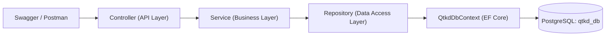

# Hệ Thống Quản Trị Kinh Doanh – QTKD API (Phase 2 – Tuần 05)

Dự án xây dựng phân hệ Backend **ASP.NET Core Web API (.NET 9)** kết nối **PostgreSQL** qua **Entity Framework Core** cho đề tài **Quản trị Kinh doanh (QTKD)** – Công ty Logistics ABC.

---

## 1. Cấu trúc Solution & Kiến trúc Phân tầng

```text
ThucHanhPhase2/
├── QTKD.sln                          # Solution chính xuyên suốt Tuần 05 – 07
├── docker-compose.yml                # Khởi chạy PostgreSQL 17 container (qtkd_db)
├── .env.example                      # Mẫu cấu hình mật khẩu PostgreSQL
├── .config/dotnet-tools.json         # Công cụ cục bộ dotnet-ef 9.0.10
├── docs/
│   └── architecture.md               # Tài liệu thiết kế kiến trúc, ERD & đối chiếu Phase 1
└── src/
    └── QTKD.Api/
        ├── Controllers/              # API Layer: CustomersController, ContractsController, PriceListsController
        ├── DTOs/                     # Hợp đồng dữ liệu trả về (Customers/, Contracts/, PriceLists/)
        ├── Services/                 # Business Logic Layer: Xử lý nghiệp vụ độc lập HTTP & DB
        ├── Mappings/                 # Chuyển đổi Entity <-> DTO
        ├── Repositories/             # Data Access Layer: Truy vấn EF Core (AsNoTracking, Include)
        ├── Data/                     # QtkdDbContext & Migrations (InitialCreate + Seed Data)
        ├── Entities/                 # Customer, Contract, PriceList, PriceItem
        ├── Exceptions/               # Xử lý lỗi tập trung theo chuẩn RFC 7807 ProblemDetails
        └── Program.cs                # Cấu hình DI, Middleware pipeline & Swagger UI
```

### Sơ đồ luồng xử lý của các thành phần chính



> Xem chi tiết sơ đồ kiến trúc thành phần và ERD tại [docs/architecture.md](docs/architecture.md).

---

## 2. Yêu cầu Môi trường

- **.NET SDK 9.0** (`dotnet --version`)
- **Docker Desktop** (hoặc PostgreSQL 15+ cài trực tiếp trên máy ở cổng `5432`)
- **Git**

---

## 3. Hướng dẫn Cấu hình Database & Chạy Migration

### Bước 1: Tạo file `.env` và khởi động PostgreSQL bằng Docker

Tại thư mục gốc của repository (`ThucHanhPhase2`):

```powershell
# Copy file .env.example thành .env (mặc định POSTGRES_PASSWORD=123456)
Copy-Item .env.example .env
# (Mở file .env chỉnh POSTGRES_PASSWORD=123456 hoặc mật khẩu tùy ý)

# Khởi động container PostgreSQL (qtkd-postgres)
docker compose up -d
```

### Bước 2: Cấu hình Connection String an toàn qua User Secrets (không lưu mật khẩu lên Git)

File `src/QTKD.Api/appsettings.json` chỉ chứa chuỗi kết nối không có mật khẩu. Để cung cấp mật khẩu trên máy local:

```powershell
dotnet user-secrets set "ConnectionStrings:QtkdDb" "Host=localhost;Port=5432;Database=qtkd_db;Username=postgres;Password=123456" --project src/QTKD.Api
```

*(Hoặc có thể đặt biến môi trường `ConnectionStrings__QtkdDb` nếu chạy trên môi trường CI/CD).*

### Bước 3: Khôi phục công cụ `dotnet-ef` và cập nhật Database (Migration + Seed Data)

```powershell
dotnet restore
dotnet tool restore
dotnet ef database update --project src/QTKD.Api
```

Lệnh trên sẽ tự động tạo 4 bảng (`customers`, `contracts`, `price_lists`, `price_items`) cùng các khóa chính, khóa ngoại, unique index và nạp sẵn **dữ liệu mẫu**:
- **2 Khách hàng (`Customer`)**:
  - `Id = 1`: `KH-001` – **Công ty TNHH Logistics Minh Phát** (`Active`)
  - `Id = 2`: `KH-002` – **Công ty Cổ phần Vận tải Biển Đông** (`Active`)
- **2 Hợp đồng (`Contract`) ở trạng thái `Draft`**:
  - `Id = 1`: `HD-2026-018` (Khách hàng `Id = 1` – Công ty Minh Phát, hiệu lực `2026-10-01` đến `2027-09-30`, trạng thái `Draft`)
  - `Id = 2`: `HD-2026-019` (Khách hàng `Id = 2` – Công ty Biển Đông, trạng thái `Draft`, đang để trống nội dung/tệp đính kèm để phục vụ kiểm thử CTR-02 ở Tuần 06)
- **1 Bảng giá (`PriceList`) kèm 2 Mục đơn giá (`PriceItem`)**:
  - `PriceList Id = 1`: *Bảng giá dịch vụ khai thác cảng tiêu chuẩn 2026* (`EffectiveDate = 2026-01-01`)
  - `PriceItem 1`: `SVC-CONT-20` – *Bốc xếp container 20 feet* (`1,250,000 VNĐ / Container`)
  - `PriceItem 2`: `SVC-STORAGE-20` – *Lưu kho bãi container 20 feet* (`180,000 VNĐ / Ngày`)

---

## 4. Khởi động API và Kiểm tra các Endpoint

### Bước 4: Chạy ứng dụng Web API

```powershell
dotnet run --project src/QTKD.Api --launch-profile http
```

- Ứng dụng lắng nghe tại: `http://localhost:5007`
- Giao diện **Swagger UI**: `http://localhost:5007/swagger`

### Bước 5: Thử các Endpoint đọc dữ liệu

| Method | Endpoint | Mô tả | Status Code |
|---|---|---|---|
| `GET` | `/api/customers` | Lấy danh sách toàn bộ khách hàng | `200 OK` |
| `GET` | `/api/customers/{id}` | Lấy chi tiết một khách hàng theo `Id` | `200 OK`, `404 Not Found` |
| `GET` | `/api/contracts` | Lấy danh sách toàn bộ hợp đồng | `200 OK` |
| `GET` | `/api/contracts/{id}` | Lấy chi tiết một hợp đồng theo `Id` (kèm tên & trạng thái khách hàng) | `200 OK`, `404 Not Found` |
| `GET` | `/api/pricelists` | Lấy danh sách bảng giá kèm danh sách `PriceItem` | `200 OK` |
| `GET` | `/api/pricelists/{id}` | Lấy chi tiết một bảng giá theo `Id` | `200 OK`, `404 Not Found` |

#### Thử nhanh bằng lệnh `curl` hoặc PowerShell:

```powershell
# 1. Đọc danh sách Customer
curl.exe -s http://localhost:5007/api/customers

# 2. Đọc chi tiết Contract HD-2026-018 (Id = 1)
curl.exe -s http://localhost:5007/api/contracts/1

# 3. Đọc chi tiết PriceList (Id = 1) kèm 2 PriceItem
curl.exe -s http://localhost:5007/api/pricelists/1
```

*(Hoặc mở file [src/QTKD.Api/QTKD.Api.http](src/QTKD.Api/QTKD.Api.http) trong VS Code / Visual Studio / Rider để bấm **Send Request** trực tiếp).*

---

## 5. Đối chiếu dữ liệu trực tiếp trong PostgreSQL

Có thể kiểm tra các bảng, khóa chính, khóa ngoại và dữ liệu trong PostgreSQL bằng câu lệnh sau:

```powershell
# Kiểm tra danh sách bảng đã tạo
docker exec qtkd-postgres psql -U postgres -d qtkd_db -c "\dt"

# Xem cấu trúc khóa chính, khóa ngoại của bảng contracts và price_items
docker exec qtkd-postgres psql -U postgres -d qtkd_db -c "\d contracts" -c "\d price_items"

# Đối chiếu dữ liệu trong các bảng
docker exec qtkd-postgres psql -U postgres -d qtkd_db -c "SELECT * FROM customers;"
docker exec qtkd-postgres psql -U postgres -d qtkd_db -c "SELECT \"Id\", \"ContractNo\", \"CustomerId\", \"StartDate\", \"EndDate\", \"ServiceGroup\", \"Status\" FROM contracts;"
docker exec qtkd-postgres psql -U postgres -d qtkd_db -c "SELECT * FROM price_lists;"
docker exec qtkd-postgres psql -U postgres -d qtkd_db -c "SELECT * FROM price_items;"
```

