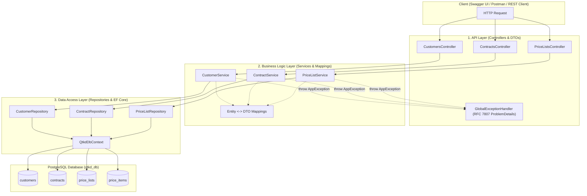
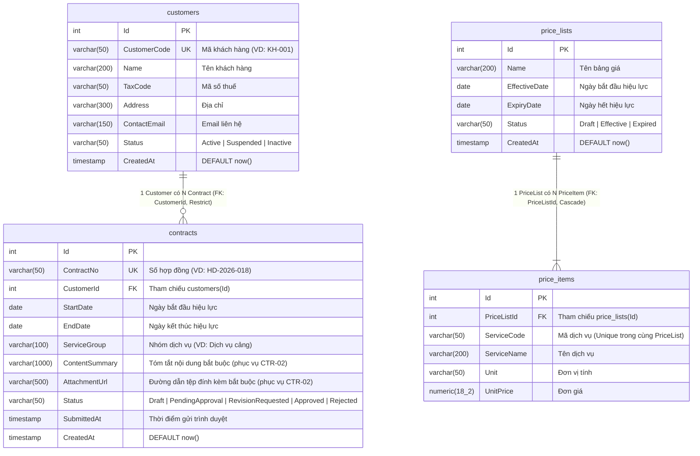

# Tài Liệu Kiến Trúc & Thiết Kế Hệ Thống QTKD (Phase 2 – Tuần 05)

## 1. Bối cảnh và Phạm vi Tuần 05
Hệ thống **Quản trị Kinh doanh (QTKD)** hỗ trợ Công ty Logistics ABC quản lý vòng đời hồ sơ kinh doanh từ **Khách hàng (`Customer`)**, **Hợp đồng (`Contract`)**, **Bảng giá (`PriceList` / `PriceItem`)** đến quy trình trình duyệt hợp đồng (**US03**).

Trong **Tuần 05**, mục tiêu trọng tâm là:
1. Xây dựng nền tảng kiến trúc phân tầng rõ ràng (**API Layer – Business Logic Layer – Data Access Layer**).
2. Thiết kế mô hình dữ liệu (`Customer`, `Contract`, `PriceList`, `PriceItem`) bám sát đặc tả Phase 1 và chuẩn bị sẵn các trường phục vụ kiểm tra quy tắc nghiệp vụ **CTR-01, CTR-02, CTR-03** ở Tuần 06.
3. Cấu hình `QtkdDbContext` với **Entity Framework Core + PostgreSQL**, quản lý chuỗi kết nối an toàn qua **User Secrets** (không lộ mật khẩu trên Git).
4. Khởi tạo Migration (`InitialCreate`), cập nhật schema vào PostgreSQL và nạp dữ liệu mẫu (Seed Data) theo đúng kịch bản xuyên suốt (*Công ty Minh Phát – Hợp đồng HD-2026-018*).
5. Cung cấp các API đọc dữ liệu (`GET /api/customers`, `GET /api/contracts/{id}`, ...) và đối chiếu với dữ liệu thực tế trong PostgreSQL.

---

## 2. Sơ đồ các thành phần chính của Solution (Component Architecture)

### Phân định trách nhiệm giữa các tầng

| Tầng (Layer) | Thành phần | Trách nhiệm chính | Nguyên tắc thiết kế |
|---|---|---|---|
| **API Layer** | `Controllers/`, `DTOs/`, `Exceptions/` | Tiếp nhận HTTP Request, trả về DTO & HTTP Status Code chuẩn (`200 OK`, `404 Not Found` qua `ProblemDetails`). | Không chứa câu truy vấn DB, không gọi trực tiếp `QtkdDbContext`. |
| **Business Logic Layer** | `Services/`, `Mappings/` | Điều phối luồng nghiệp vụ, kiểm tra quy tắc nghiệp vụ (`CTR-01`, `CTR-02`, `CTR-03`), chuyển đổi giữa `Entity` và `DTO`. | Độc lập với HTTP (`IActionResult`) và độc lập với EF Core để dễ viết Unit Test ở Tuần 07. |
| **Data Access Layer** | `Repositories/`, `Data/`, `Entities/` | Đóng gói truy vấn EF Core (`AsNoTracking`, `Include`), cấu hình Fluent API, quản lý Migration và Seed Data. | Chỉ tập trung đọc/ghi dữ liệu, không tự quyết định quy tắc nghiệp vụ. |

---

## 3. Sơ đồ Quan hệ Thực thể (ERD) trong PostgreSQL

---

## 4. Liên kết với Kết quả Phase 1 (US03 & Business Rules)

Để đảm bảo schema tạo ở Tuần 05 sử dụng xuyên suốt sang Tuần 06 và Tuần 07 mà không phải đập đi xây lại, mô hình `Contract` và `Customer` đã tích hợp sẵn các thuộc tính phục vụ **US03 (Gửi hợp đồng trình duyệt)**:
- **CTR-01** (*Chỉ được chỉnh sửa hợp đồng ở trạng thái `Draft` hoặc `RevisionRequested`*): Kiểm soát qua trường `Contract.Status` (`ContractStatus` constants).
- **CTR-02** (*Hợp đồng chỉ được Submit khi có khách hàng hợp lệ, thời gian hiệu lực hợp lệ và có ít nhất một tệp/hạng mục nội dung bắt buộc*):
  - Khách hàng hợp lệ: `Customer` tồn tại và `Customer.Status == "Active"`.
  - Thời gian hiệu lực hợp lệ: `StartDate <= EndDate`.
  - Nội dung & tệp đính kèm bắt buộc: `ContentSummary` và `AttachmentUrl` (đã khai báo sẵn trên bảng `contracts`).
- **CTR-03** (*Không được chuyển trực tiếp từ `Draft` sang `Approved`*): Luồng Submit chỉ chuyển `Status` sang `PendingApproval` và ghi nhận `SubmittedAt`.

